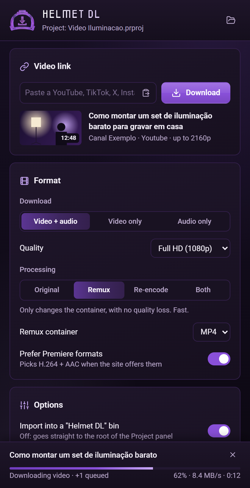

# Helmet DL

**English** · [Português](README.pt-BR.md)

A CEP extension for Adobe Premiere Pro that downloads videos from YouTube, TikTok, X, Instagram, Twitch and [over a thousand sites supported by yt-dlp](https://github.com/yt-dlp/yt-dlp/blob/master/supportedsites.md), saves them in a `Helmet DL` folder next to your project and imports the file straight into the **Project** panel (never into the timeline).

Same visual identity as [Helmet Desk](https://github.com/derpbizinoto/helmet-desk), Classic theme (Violet Terminal with subtle gradients), with Geo in caps for the name and Roboto everywhere else.

Free and open source ([MIT license](LICENSE)).



**[⬇ Download the latest version](https://github.com/derpbizinoto/helmet-dl/releases/latest)**: Premiere Pro on Windows.

## Installation

1. Download `HelmetDL-<version>.zip` from the [releases page](https://github.com/derpbizinoto/helmet-dl/releases/latest) and extract it.
2. Close Premiere.
3. Run `instalar.bat` (double-click; no administrator needed). It copies the extension to `%APPDATA%\Adobe\CEP\extensions\` and allows unsigned extensions (`PlayerDebugMode`).
   Manual alternative: copy the `premiere-helmet-dl` folder to `C:\Program Files (x86)\Common Files\Adobe\CEP\extensions\` and run `Add Keys.reg`.
4. In Premiere: **Window › Extensions › Helmet DL**.

You don't need to install Python, yt-dlp or FFmpeg yourself. On the first download the extension fetches:

| Tool | What for | Source |
|---|---|---|
| yt-dlp | the download itself (the official `.exe` has Python built in) | github.com/yt-dlp/yt-dlp |
| FFmpeg + FFprobe | merging audio and video, remux, reencode, audio extraction | github.com/yt-dlp/FFmpeg-Builds |
| Deno | JavaScript runtime that yt-dlp needs to read YouTube | github.com/denoland/deno |

Everything goes into `%APPDATA%\Helmet DL\bin`. If FFmpeg/Deno/yt-dlp is already on the PATH (winget, scoop, choco, pip), that one is used. The yt-dlp managed by the extension updates itself once a day (can be turned off under **Tools**).

## How to use

1. Save the project (the `Helmet DL` folder is created next to the `.prproj`).
2. Paste the link (or use the paste button): a preview shows the title, duration and highest resolution.
3. Pick the options and click **Download** (or press Enter). You can paste several links at once, separated by spaces: they all go into the queue.

### Options

- **Download:** Video + audio, Video only or Audio only.
- **Quality:** Original (highest), 8K, 4K, 2K, 1080p, 720p, 480p, 360p, 240p, 144p. It uses the smaller dimension, so "1080p" also works for vertical videos (Shorts, TikTok, Reels). If the video doesn't have the requested quality, it gets the closest one below.
- **Processing:**
  - *Original*: as the site delivers it, no conversion.
  - *Remux*: only changes the container (MP4, MOV or MKV), no quality loss.
  - *Reencode*: converts to H.264, H.265 or ProRes 422 with a constant frame rate (avoids out-of-sync phone/TikTok/Twitch videos in Premiere). The intermediate file is deleted.
  - *Both*: does the remux **and** a reencoded copy; both go to the Project panel.
  - *Reencode using CPU or GPU*: on the GPU, encoding uses NVIDIA NVENC, AMD AMF or Intel Quick Sync (detected automatically). It's faster and frees the CPU, with a slightly larger file. If the GPU fails, the reencode is redone on the CPU. ProRes always uses the CPU.
- **Prefer Premiere formats:** prefers H.264 + AAC when the site offers it (YouTube up to 1080p, usually). Above that YouTube only has VP9/AV1, so use Reencode.
- **Audio format** (Audio only): WAV, MP3 320k, M4A or original.
- **Import into a "Helmet DL" bin:** when off, imports into the root of the Project panel.
- **Download the whole playlist.**
- **Download only a section:** start/end in seconds or `hh:mm:ss`. The cut lands on the nearest keyframe.
- **Browser cookies:** for Instagram, private or age-restricted videos. Firefox is the most reliable; Chrome/Edge must be closed.
- **Language / Idioma:** English (default) or Portuguese. Switches instantly and is saved. Finished items in the list and the Log stay in the language they were written in.

If the final file has a codec Premiere usually can't open (VP9, AV1, Opus…), the item turns yellow in the list with a warning.

## Structure

```
instalar.bat              installs for the current user (no administrator)
Add Keys.reg              manual alternative: allows unsigned extensions (CSXS 9 to 16)
empacotar.ps1             builds dist\HelmetDL-<version>.zip for distribution
tests/                    automated tests (node tests\run-tests.js)
AUDITORIA.md              security and cleanup audit (Portuguese)
CHANGELOG.md              what changed in each version (Portuguese)

premiere-helmet-dl/
  CSXS/manifest.xml       CEP manifest (Node enabled; see "Security")
  host/index.jsx          ExtendScript: project path and import into the Project panel
  client/index.html       panel
  client/css/style.css    Violet Terminal identity
  client/js/
    config.js             everything configurable: version, names, timeouts,
                          tool addresses; turns the debug log on/off
    i18n.js               panel language and the English translation dictionary
    bridge.js             the only channel to Premiere (ExtendScript)
    tools.js              finds/installs/updates yt-dlp, FFmpeg and Deno; runs processes
    downloader.js         yt-dlp arguments, progress, FFmpeg reencode, file names
    ui.js                 screen elements, options, saved settings, log
    project.js            open project and "Helmet DL" folder
    preview.js            link validation and preview (title, thumbnail, duration)
    tools-ui.js           "Tools" card and automatic yt-dlp update
    clipboard.js          paste button
    queue.js              download queue and footer progress bar
    main.js               wires the buttons to the modules and starts the panel
```

The files in `client/js/` are loaded by `index.html` in that order (each one uses the ones above it).

### Translations

The source code is written in Portuguese (inside `tr("…")`) and so is `index.html`. The English translation lives in the `EN` dictionary in `client/js/i18n.js`, keyed by the Portuguese sentence. Any new on-screen sentence needs a new entry there: the automated tests fail if one is missing.

## Security

The panel runs with Node.js enabled (`--enable-nodejs` and `--mixed-context` in `manifest.xml`), because it needs to run yt-dlp and FFmpeg and write files. Because of that:

- **Links:** only `http://` and `https://`. The link is passed to yt-dlp after a `--`, so it's never read as an option.
- **Programs:** always called with a separate argument list (no command strings are built). Windows programs (PowerShell, taskkill, tar, explorer) are called by their full path. All of them have a timeout and are terminated when the panel closes.
- **Downloaded tools:** only from GitHub, over HTTPS, and only installed if the SHA-256 matches the one published on the official page. If it doesn't match, the file is deleted and the previous version stays.
- **Files:** names are sanitized (no slashes, forbidden characters or reserved Windows names), always stay inside the `Helmet DL` folder and never overwrite an existing file (they get "(2)", "(3)"…). Downloads that are canceled, fail or are interrupted by closing the panel have their leftovers (`.part`, fragments, incomplete reencode and, in Reencode mode, the intermediate original) deleted.
- **Screen:** text coming from the internet (titles, messages) is inserted as text, never as HTML. No code is loaded from outside (no CDN, no `eval`).
- **Cookies:** the "Browser cookies" option only passes the browser's **name** to yt-dlp (`--cookies-from-browser firefox`). yt-dlp itself reads the cookies at that moment; the extension never sees, stores or logs their contents.
- **Signing:** the extension isn't signed yet, so the installer turns on `PlayerDebugMode` (which allows unsigned extensions). Signing with a certificate is still pending.

## Development

### Tests

```
node tests\run-tests.js
```

Runs without Premiere and without internet: file name sanitizing, accepted/rejected links, SHA-256 checks, yt-dlp arguments, error messages and the conversation with Premiere (on top of a fake API in `tests/premiere-mock.js`). What can only be seen in Premiere needs manual testing: the checklist used for 1.1.0 is still in the git history (`git show dd621c3:TESTES.md`, Portuguese).

### Debugging

The `.debug` file is **not** part of the repository or the package (it opens a debugging port on the computer). On the development machine, create `premiere-helmet-dl\.debug` with:

```xml
<?xml version="1.0" encoding="UTF-8"?>
<ExtensionList>
    <Extension Id="com.seuestudio.helmetdl.panel">
        <HostList>
            <Host Name="PPRO" Port="8098" />
        </HostList>
    </Extension>
</ExtensionList>
```

With the panel open, go to `http://localhost:8098` in Chrome. For extra technical messages, change `DEBUG: false` to `true` in `client/js/config.js` (never distribute it like that). The panel's **Log** card shows the exact yt-dlp/FFmpeg commands and their output.

To see the UI outside Premiere, serve the `client` folder with a local server (for example `py -3 -m http.server` inside it) and open `index.html?demo`: the queue shows up filled with examples.

### New version

1. Change the version in three places: `CSXS/manifest.xml` (`ExtensionBundleVersion` and `Extension Version`), `client/js/config.js` (`CLIENT_VERSION`) and `host/index.jsx` (`HDL_HOST_VERSION`).
2. Note it in `CHANGELOG.md`.
3. Run `node tests\run-tests.js` and test in Premiere.
4. Run `powershell -ExecutionPolicy Bypass -File empacotar.ps1`. It checks that the three versions match, builds `dist\HelmetDL-<version>.zip` with only what's needed and **stops with an error** if it finds a `.debug`, certificate, key or cookies file.

## Credits

Embedded in `client/fonts/` (with the license text), copied from Helmet Desk. The panel doesn't go online to use them.

| Font | Use | Author | License |
|---|---|---|---|
| [Geo](https://fonts.google.com/specimen/Geo) (Regular) | "HELMET DL" name | Ben Weiner | SIL Open Font License 1.1 |
| [Roboto](https://fonts.google.com/specimen/Roboto) (Regular, Medium, SemiBold, Bold) | Everything else | The Roboto Project Authors | SIL Open Font License 1.1 |

## License

[MIT](LICENSE). The Geo and Roboto fonts have their own license (SIL Open Font License 1.1, see `client/fonts/`). yt-dlp, FFmpeg and Deno are not bundled: they're downloaded from the official projects and follow their own licenses.
